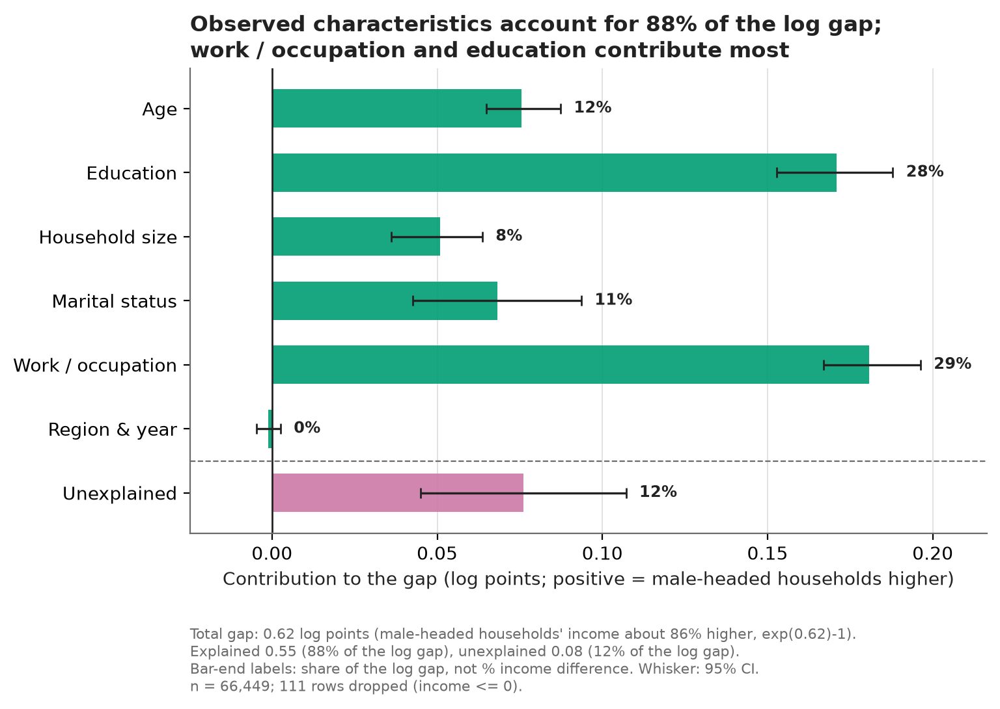
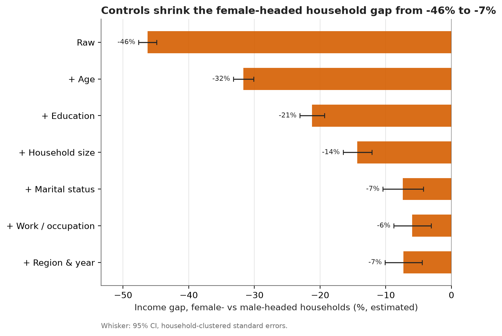
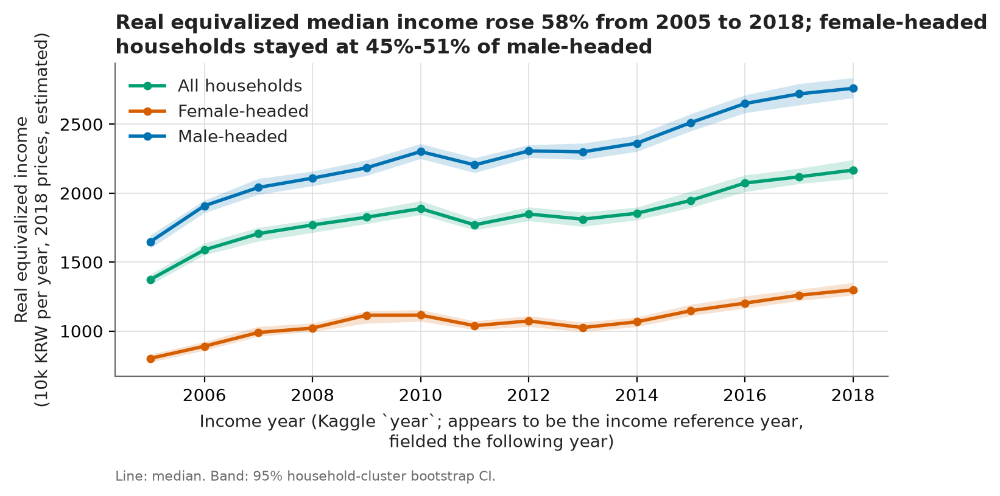

# Female-headed households and income in Korea

Korea Income and Welfare panel, 92,857 household-years, data years 2005-2018. Python, pandas, statsmodels.

**Answer.** Female-headed households have 46% lower real equivalized income than male-headed households (mean log gap, 2008-2017). Observed differences in household composition and in the head's age, education and work/occupation account for 88% of that log gap (85% to 91% across reference coefficients), with work/occupation (29%) and education (28%) the largest pieces. Age, education and work/occupation alone account for 69%; the rest of the explained part is household makeup and marital status. After all controls, female-headed households' income is 7.3% lower (95% CI 4.5% to 10.1%, household-clustered): an association in this unweighted sample, not a causal effect or a measure of discrimination.



Income unit (10k KRW per year) is estimated and income year (Kaggle `year`; appears to be the income reference year, fielded the following year) is inferred; see [Limitations](#limitations).

Full analysis: [`notebooks/analysis.ipynb`](notebooks/analysis.ipynb) (an nbviewer link can be added after the repository is published). Every judgment call: [`docs/analysis_decisions.md`](docs/analysis_decisions.md).

## Key results

| | Value |
|---|---|
| Raw gap, mean log real equivalized income (2008-2017) | 0.621 log points, about 46% lower |
| Raw gap, median real equivalized income (all years) | 52% lower |
| Gap after all controls (staged OLS, household-clustered SE) | 7.3% lower (95% CI 4.5% to 10.1% lower) |
| Explained share of the log gap (pooled Oaxaca-Blinder) | 88% (0.545 log points) |
| Unexplained share of the log gap | 12% (0.076 log points, 95% CI 0.045 to 0.107) |
| Largest explained pieces | Work/occupation 0.181 (29%), education 0.171 (28%) |
| Age, education and work/occupation together | 69% of the log gap |
| Marital status + household size | 19% of the log gap together (largely definitional, see below) |
| Explained share across reference coefficients (pooled, male, female) | 85% to 91% |
| Controlled gap across four specifications | 7.2% to 8.2% lower |
| Controlled gap across quantiles 0.10 to 0.90 | 6.3% to 11.2% lower at conditional quantiles, widest at the 90th (CIs not clustered) |

Shares are shares of the log gap; the percent gaps are income differences. The two are different units and do not add up to each other.





Real equivalized median income rose 58% from income year 2005 to 2018, and female-headed households stayed at 45% to 51% of the male-headed median in every year. This is the panel's trend, not Korea's: the panel ages (median head age 53 to 64) and 1,878 households join in 2011.

More figures in [`reports/figures/`](reports/figures/): quantile gaps, regional map, education, age and occupation medians.

## Why this is harder than it looks

- **Income is household income; "gender" is the head's.** Person attributes describe the household head, so the comparison is female-headed vs male-headed households, not women vs men. Female-headed households are much smaller (1.50 vs 2.90 people, 68% live alone), so the income measure changes the answer: the median gap is 68% on raw household income, 52% equivalized (income / sqrt(size)) and 29% per person (the original course metric).
- **It is a panel, and heads change.** 10,046 households are observed up to 14 times. 1,428 ids change head gender or birth year across waves (1,284 change head gender), for example when a husband dies and his wife becomes head. 1,878 households join in 2011 (consistent with a reported refresh sample). All CIs therefore resample or cluster whole households.
- **Nominal vs real, and which year.** The Kaggle extract ships without a codebook. The unit is read as 10k KRW per year because only that reading gives a plausible annual income (about 30 million KRW median in 2018). Kaggle `year` appears to be the income reference year already (inference: year 2005 has exactly the 7,072 households of the source survey's first wave, fielded in 2006 about 2005 income, and the 2011 newcomers match the refresh sample fielded in 2012). Income is deflated to 2018 prices with that year's World Bank CPI for Korea.
- **Negative, zero and extreme incomes.** 232 rows have income <= 0; they stay in medians and are dropped from log models with a count (111 in the model sample). Medians and logs limit the influence of the long right tail; a 1st/99th percentile winsorized run gives 7.5% vs 7.3% lower.
- **Occupation codes change meaning in 2008.** Unmapped occupation codes are 44% to 45% of coded rows in 2005-2007, 0.0% in 2008-2017 and 3.4% in 2018, and the occupation mix shifts 6.1% between 2007 and 2008 vs 0.7% to 2.3% in other years. This looks like a classification change, so models with occupation use data years 2008-2017 only. Military codes (1011, 1012) form their own "Armed forces" group and the unknown code 9999 is treated as missing.
- **Documented labels contradicted by the data.** Non-work reason code 4, documented as "prepare for school", is 704 rows, 95% female-headed, median head age 68, 78% widowed. The reason labels are not trusted; models use the raw codes without labels.
- **Marital status labels are inferred.** Codes ship without labels. Code 2 is 89% female-headed with median head age 74 and median household size 1, which fits "Widowed" under the source survey's usual convention; labels are inferred, not confirmed. On that reading, 68% of female-headed household-years (all years) are widowed heads.

## Methods

- **Outcome:** log real equivalized household income (income / sqrt(household size), 2018 prices, World Bank `FP.CPI.TOTL` rebased 2018 = 100).
- **Group medians:** 95% CIs from a household-cluster bootstrap (1,000 draws, seed 42); groups with fewer than 100 household-years suppressed.
- **Staged OLS:** female-head dummy, then age (quadratic), education, household size, marital status, work status/occupation major group, region and year fixed effects. Standard errors clustered by household. Percent gap = exp(coef) - 1.
- **Oaxaca-Blinder (headline):** pooled two-fold decomposition (Neumark / Jann) by variable group, 95% CIs from a 500-draw household-cluster bootstrap. Reference-coefficient sensitivity with male and female coefficients.
- **Quantile regression** at conditional quantiles 0.10, 0.25, 0.50, 0.75, 0.90 (of log income given the full controls, not of the raw distribution).
- **Robustness:** winsorized outcome, non-equivalized household income, all years without occupation terms.
- **Engineering:** analysis code in the `kwincome` package (`src/`), pytest suite (cleaning edge cases, cluster bootstrap keeps households whole, log models drop income <= 0 with a count, end-to-end notebook execution), and a check cell that asserts every number quoted in the notebook's summary.

The staged steps depend on the order in which controls enter; the decomposition does not, so attribution rests on the decomposition.

## Limitations

- Income unit (10k KRW per year) is estimated, and income year = Kaggle `year` is inferred from the sample design (the data appear to be fielded the following year); neither is confirmed by a codebook. If `year` were the fieldwork year instead, levels and the trend would shift by one CPI year; the controlled gap and the decomposition would not, because the models include year fixed effects.
- No survey weights in this extract. The source survey is reported to oversample low-income households, so results describe this sample, not Korea.
- Household heads, not individuals. Who becomes a head (widowhood, divorce, living alone in old age) is itself selected. Education, work and occupation describe the head only, while income is household-wide.
- "Explained" means composition, not causes. Marital status and household size (19% of the log gap) largely restate what female headship means here.
- The unexplained 12% is a residual after observed controls, not a measure of discrimination; hours, wealth, transfers and health sit inside it.
- Occupation is only comparable in data years 2008-2017. Marital status labels are inferred, non-work reason labels are not used, and the province-to-region grouping for the map is assumed.
- Quantile regression CIs are not clustered by household and are likely too narrow. OLS and Oaxaca CIs are household-clustered.
- Pooled reference coefficients are one standard choice; male or female coefficients give an explained share of 85% to 91%.

## Project structure

```
src/kwincome/        load, clean, codes, features, stats, models, plots, geo
tests/               pytest suite (synthetic data + notebook execution + repo hygiene)
notebooks/           analysis.ipynb (executed, with outputs)
reports/figures/     PNGs written by the notebook
data/raw/            Kaggle CSV and job-code table (git-ignored, download yourself)
data/external/       CPI and province boundaries, with SOURCES.md
docs/                analysis_decisions.md (every judgment call)
LICENSE              MIT, code only (not the data)
```

## Reproduce

Requires Python 3.12.

1. Download the Kaggle dataset "Korea Income and Welfare" (https://www.kaggle.com/datasets/hongsean/korea-income-and-welfare) and put `Korea Income and Welfare.csv` and `job_code_translated.xlsx` in `data/raw/`.
2. Set up the environment and install the package in editable mode:

   ```
   python -m venv .venv
   .venv\Scripts\Activate.ps1      # Windows PowerShell (run one of these two lines)
   source .venv/Scripts/activate   # Git Bash (macOS/Linux: source .venv/bin/activate)
   pip install -r requirements.txt
   pip install -e .
   ```

   `requirements.txt` pins the direct dependencies; `requirements-lock.txt` is the full `pip freeze` of the environment that produced the outputs (Windows), for an exact rebuild.
3. Run the tests (the notebook test executes the full notebook and takes a few minutes; it writes figures to a temporary folder): `pytest -q`
4. Re-execute the notebook and regenerate the figures:

   ```
   jupyter nbconvert --to notebook --execute --inplace notebooks/analysis.ipynb
   ```

## Data sources and licenses

- **Korea Income and Welfare** (Kaggle, https://www.kaggle.com/datasets/hongsean/korea-income-and-welfare), an extract of the Korea Welfare Panel Study. License: CC0: Public Domain, as listed for the dataset on Kaggle (checked 2026-11-26). The raw data and the job-code mapping table are not redistributed in this repository.
- **CPI:** World Bank, World Development Indicators, `FP.CPI.TOTL` (Korea, Rep.), CC BY 4.0. Stored in `data/external/cpi_kor.csv`.
- **Province boundaries:** geoBoundaries gbOpen KOR ADM1 (simplified), public domain as reported by geoBoundaries; citation Runfola et al. (2020), PLoS ONE 15(4): e0231866. Details in [`data/external/SOURCES.md`](data/external/SOURCES.md).

- **Code:** MIT License ([`LICENSE`](LICENSE)). The license covers the code in this repository, not the data.

## Before publishing

`KWINCOME_PUBLISH_CHECK=1 pytest tests/test_hygiene.py` also checks that the local git identity and every commit email use a GitHub noreply address. Those two checks are skipped by default because they depend on the local git setup.

## Provenance

Extended from my 2025 IST256 (Syracuse University) course project. As a self-directed project, I re-audited the original analysis with AI assistance (Claude), identified where it could mislead (household-level income read as individual income, repeated households, nominal values, outliers), and rebuilt it with stronger methods and tested code.
